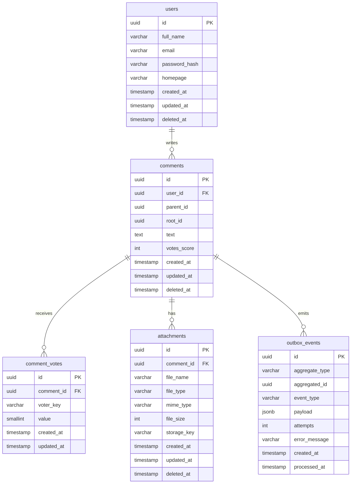

# Comments — монорепозиторій

SPA «Коментарі»: користувачі залишають повідомлення з капчею, переглядають стрічку з сортуванням і пагінацією, прикріплюють файли. Backend — NestJS + PostgreSQL; frontend — Next.js.

Репозиторій: https://github.com/p1982/comments

### Live Demo (Railway)

| Сервіс             | URL                                                                    |
| ------------------ | ---------------------------------------------------------------------- |
| Web (UK / EN)      | https://comments-front-production.up.railway.app/uk                    |
| API Health         | https://comments-back-production-228b6ee2.up.railway.app/api/v1/health |
| Swagger UI         | https://comments-back-production-228b6ee2.up.railway.app/api/v1/docs   |
| GraphQL Playground | https://comments-back-production-228b6ee2.up.railway.app/graphql       |

Детальна конфігурація Railway (env, Volume, чекліст перевірки) — у [`docs/deploy.md`](docs/deploy.md).

## Зміст

1. [Що вміє продукт](#що-вміє-продукт)
2. [Стек і версії](#стек-і-версії)
3. [Бібліотеки (опис + версії)](#бібліотеки-опис--версії)
4. [Структура](#структура)
5. [Запуск з нуля](#запуск-з-нуля)
6. [База даних](#база-даних)
7. [Тести](#тести)
8. [Git: гілки, коміти, husky](#git-гілки-коміти-husky)
9. [CI](#ci)
10. [Скрипти](#скрипти)
11. [Документація](#документація)
12. [GraphQL-запити (Playground та curl)](#graphql-запити-playground-та-curl)
13. [Покрокова перевірка всіх сценаріїв (чекліст + HTML-приклади)](#покрокова-перевірка-всіх-сценаріїв-чекліст--html-приклади)

## Що вміє продукт

| Функція             | Опис                                                                                     |
| ------------------- | ---------------------------------------------------------------------------------------- |
| Форма коментаря     | ім’я, email, текст (`[i]`, `[strong]`, `[code]`, `[a]`), homepage, SVG CAPTCHA + refresh |
| Попередній перегляд | як виглядатиме текст до відправки без перезавантаження сторінки                          |
| Список / таблиця    | корені коментарів, сортування із синхронізацією в URL (`sort`, `order`), сторінки        |
| Відповіді           | вкладені коментарі під коренем із лічильником відповідей та розгортанням гілки           |
| Дії та голосування  | лайки / дизлайки (`votes_score` / `comment_votes`), цитування, копіювання, обране        |
| Файли               | зображення (fit до 320×240 через sharp + lightbox) і текстові вкладення (`.txt`)         |
| Пошук               | повнотекстовий і підрядковий пошук (Elasticsearch + fallback на PostgreSQL `ILIKE`)      |
| Auth                | JWT у httpOnly cookies (`signup` / `signin` / `refresh` + автовідновлення сесії)         |
| Live                | нові коментарі (`comment.created`) та голоси (`comment.voted`) по Socket.IO              |
| API                 | REST `/api/v1` (Swagger `/api/v1/docs`) і GraphQL `/graphql`                             |
| i18n                | локалі `/en`, `/uk`                                                                      |

Write path: create пише коментар + outbox в одній TX і бампить list-cache; WS / ES / черга зображень — асинхронно, щоб не блокувати список.

## Стек і версії

| Шар             | Технологія                                    | Версія                                        |
| --------------- | --------------------------------------------- | --------------------------------------------- |
| Runtime         | Node.js                                       | **22.22.1** (див. `.nvmrc`)                   |
| Package manager | npm                                           | **≥10.9.4** (`packageManager`: npm@10.9.4)    |
| Монорепо        | NX                                            | **24.0.4**                                    |
| Мова            | TypeScript                                    | **~6.0.3**                                    |
| API             | NestJS                                        | **^11**                                       |
| ORM / БД        | TypeORM + PostgreSQL                          | TypeORM **^0.3.31**, Postgres **16** (Docker) |
| Web             | Next.js                                       | **~16.4.1**                                   |
| UI              | React / MUI                                   | React **^19**, MUI **^9.5**                   |
| Черга           | RabbitMQ                                      | **3** (Docker image)                          |
| Пошук           | Elasticsearch                                 | **8.15.3** (Docker) + клієнт **^8.15**        |
| Якість          | ESLint / Prettier / Jest / Playwright / Husky | див. таблиці нижче                            |

## Бібліотеки (опис + версії)

Версії з кореневого `package.json` / workspace (діапазон `^` / `~` як у lock). Повний список — `package-lock.json`.

### Runtime / платформа (Docker)

| Пакет / образ   | Версія                               | Навіщо                                             |
| --------------- | ------------------------------------ | -------------------------------------------------- |
| `postgres`      | 16-alpine                            | основна БД                                         |
| `elasticsearch` | 8.15.3                               | індекс пошуку коментарів                           |
| `rabbitmq`      | 3-management-alpine                  | опційна черга джобів (`COMMENT_QUEUE_MODE=rabbit`) |
| k6              | окремий бінарник (`brew install k6`) | навантажувальні тести (не npm)                     |

### Backend (API)

| Бібліотека                                                        | Версія                | Опис                              |
| ----------------------------------------------------------------- | --------------------- | --------------------------------- |
| `@nestjs/common` / `core` / `platform-express`                    | ^11                   | HTTP API Nest                     |
| `@nestjs/config`                                                  | ^12                   | конфіг з `.env`                   |
| `@nestjs/typeorm` + `typeorm` + `pg`                              | ^11 / ^0.3.31 / ^8.23 | ORM + драйвер Postgres            |
| `@nestjs/jwt`                                                     | ^12                   | access / refresh токени           |
| `@nestjs/graphql` + `@nestjs/apollo` + `graphql`                  | ^13 / ^13 / ^16.14    | GraphQL schema + Apollo           |
| `@apollo/server` + `@as-integrations/express5`                    | ^5 / ^1.1             | GraphQL HTTP на Express 5         |
| `graphql-upload`                                                  | ^16                   | multipart upload у GraphQL        |
| `@nestjs/websockets` + `@nestjs/platform-socket.io` + `socket.io` | ^11 / ^11 / ^4.8      | realtime `comment.created`        |
| `@nestjs/microservices` + `amqplib` + `amqp-connection-manager`   | ^11 / ^2.4 / ^5       | RabbitMQ транспорт                |
| `@nestjs/cache-manager` + `cache-manager`                         | ^12 / ^7.2            | in-process list cache             |
| `@nestjs/event-emitter`                                           | ^12                   | внутрішні події / outbox publish  |
| `@nestjs/swagger`                                                 | ^11.4 (api workspace) | OpenAPI UI `/api/v1/docs`         |
| `@elastic/elasticsearch`                                          | ^8.15                 | клієнт ES 8.x                     |
| `class-validator` + `class-transformer`                           | ^0.15 / ^0.5          | валідація GraphQL input / DTO     |
| `cookie-parser`                                                   | ^1.4                  | JWT / captcha cookies             |
| `bcrypt`                                                          | ^6 (api)              | хеш паролів                       |
| `sharp`                                                           | ^0.35                 | fit зображень                     |
| `zod`                                                             | ^4.6                  | схеми тіл запитів (REST + shared) |
| `rxjs` + `reflect-metadata`                                       | ^7.8 / ^0.2           | Nest DI / streams                 |

### Frontend (Web)

| Бібліотека                                                       | Версія       | Опис                                  |
| ---------------------------------------------------------------- | ------------ | ------------------------------------- |
| `next`                                                           | ~16.4.1      | App Router, SSR/CSR                   |
| `react` / `react-dom`                                            | ^19          | UI                                    |
| `@mui/material` + `@mui/icons-material` + `@mui/material-nextjs` | ^9.5         | компоненти / іконки / Next інтеграція |
| `@emotion/react` + `@emotion/styled`                             | ^11.14       | emotion для MUI                       |
| `styled-components`                                              | ^6.6         | styled UI                             |
| `react-hook-form` + `@hookform/resolvers`                        | ^7.91 / ^7.0 | форми + zod resolver                  |
| `next-intl`                                                      | ^4.14        | i18n en/uk                            |
| `zustand`                                                        | ^5.1         | клієнтський стор коментарів           |
| `@apollo/client` + `@apollo/client-integration-nextjs`           | ^4.3 / ^0.14 | GraphQL клієнт (де використовується)  |
| `axios`                                                          | ^1.21        | HTTP до REST API                      |
| `socket.io-client`                                               | ^4.8         | підписка на нові коментарі            |
| `zod`                                                            | ^4.6         | валідація на клієнті                  |
| `dompurify` + `jsdom`                                            | ^3.4 / ^29   | санітизація HTML                      |
| `dayjs`                                                          | ^1.11 (web)  | дати                                  |
| `react-toastify`                                                 | ^11.2 (web)  | тости                                 |

### Shared / якість / інструменти

| Бібліотека                                | Версія       | Опис                    |
| ----------------------------------------- | ------------ | ----------------------- |
| `nx` (+ `@nx/*`)                          | 24.0.4       | монорепо таски          |
| `typescript`                              | ~6.0.3       | компіляція              |
| `eslint` + `typescript-eslint`            | ^9.8 / ^8.58 | лінт                    |
| `eslint-config-next` + react-плагіни      | ^16.1 / …    | правила Next/React      |
| `prettier`                                | ~3.6.2       | форматування            |
| `jest` + `@swc/jest` + `ts-jest`          | ~30.5 / …    | unit-тести              |
| `@playwright/test`                        | ^1.65        | браузерні e2e           |
| `supertest`                               | ^7.3         | HTTP e2e API            |
| `husky`                                   | ^9.1.7       | git hooks               |
| `lint-staged`                             | ^17.6        | lint лише staged файлів |
| `@commitlint/cli` + `config-conventional` | ^21.2        | Conventional Commits    |
| `webpack` + `webpack-cli`                 | ~5.112 / ^7  | збірка API              |
| `@swc/core` / `@swc/cli`                  | ~1.15 / ~0.8 | швидка транспіляція     |

## Структура

```
apps/api          NestJS API (коментарі, auth, captcha, outbox, search, GraphQL, WS)
apps/web          Next.js UI
apps/e2e          Playwright (браузер)
apps/load         k6 load (create + list)
packages/shared   спільні схеми / DTO / утиліти
docs/             scale, load-report, схеми БД, git-конвенції
```

## Запуск з нуля

Потрібні **Node.js 22.22.1**, **Docker** (Postgres; для повного стеку — RabbitMQ / ES).

### Варіант A — усе в Docker

```bash
git clone https://github.com/p1982/comments.git
cd comments
cp .env.example .env
npm run docker:up
```

| Сервіс  | URL                                 |
| ------- | ----------------------------------- |
| Web     | http://localhost:3000               |
| API     | http://localhost:3001/api/v1        |
| Health  | http://localhost:3001/api/v1/health |
| Swagger | http://localhost:3001/api/v1/docs   |
| GraphQL | http://localhost:3001/graphql       |

Зупинка: `npm run docker:down`.

### Варіант B — локальна розробка

```bash
git clone https://github.com/p1982/comments.git
cd comments
nvm use
cp .env.example .env
npm install
npm run db:up
```

Для `nx serve` потрібен доступний Postgres на `DB_HOST` з `.env` (зазвичай `localhost:5432` — пробрось порт у compose або використай локальний Postgres).

```bash
npm run migration:run          # якщо DB_SYNC=false
docker compose up -d elasticsearch   # опційно пошук
npm run dev
# npm run dev:api  → :4000 (API_PORT=4000; дефолт у Docker / PORT — :3001)
# npm run dev:web  → :3000
```

```bash
curl -m 3 http://localhost:4000/api/v1/health   # або :3001 у Docker
open http://localhost:3000/uk
```

## База даних

Таблиці: `users`, `comments` (включно з `votes_score`), `comment_votes`, `attachments`, `outbox_events`.

- Стартовий знімок (MySQL Workbench): [`docs/comments-schema.sql`](docs/comments-schema.sql)
- Попередній знімок міграцій (до голосування): [`docs/comments-schema-current.sql`](docs/comments-schema-current.sql)
- Актуальна схема за всіма міграціями (`votes_score` + `comment_votes`): [`docs/comments-schema-latest.sql`](docs/comments-schema-latest.sql)



_Початкова діаграма проєктування (MySQL Workbench, для порівняння зі стартовим знімком):_


## Тести

| Команда                         | Що перевіряє                                                     | Де                             | Потрібно                           |
| ------------------------------- | ---------------------------------------------------------------- | ------------------------------ | ---------------------------------- |
| `npm run test`                  | unit / integration Jest (api, web, shared), coverage ~90% на API | локально + husky pre-push + CI | нічого додаткового                 |
| `npm run test:api`              | Nest HTTP e2e (`comments.e2e-spec` тощо)                         | CI + вручну                    | Postgres                           |
| `npm run test:e2e`              | Playwright: форма, preview, список, sort, пагінація, файл        | вручну                         | API + web (або auto-start web)     |
| `npm run test:load`             | k6 create+list (REST / GraphQL), профілі smoke/local/peak        | вручну                         | API + Postgres + `brew install k6` |
| `npm run typecheck`             | TS api + shared                                                  | husky + CI                     | —                                  |
| `npm run lint` / `format:check` | ESLint / Prettier                                                | husky + CI                     | —                                  |
| `npm run check`                 | гілка + format + lint + typecheck + `test`                       | вручну / дзеркало pre-push     | —                                  |

Деталі:

- Browser e2e → [`apps/e2e/README.md`](apps/e2e/README.md)
- Load → [`apps/load/README.md`](apps/load/README.md), звіт → [`docs/load-report.md`](docs/load-report.md)
- **Load не в husky і не в обов’язковому CI gate** (потрібен живий API + бінарник k6)

Приклади:

```bash
npm run test
npm run test:api
npm run test:e2e
LOAD_TRANSPORT=graphql npm run test:load
```

## Git: гілки, коміти, husky

Повний гайд також у [`docs/GIT_CONVENTIONS.md`](docs/GIT_CONVENTIONS.md). Ім’я гілки перевіряється на **pre-commit**, **pre-push** і в CI (`npm run check:branch`).

### Довгоживучі гілки

`main` | `master` | `develop`

### Feature-гілки — формат імені

```text
<type>/<description>
<type>/<ticket>-<description>
```

**Типи:** `feature` | `fix` | `hotfix` | `release` | `chore` | `docs` | `refactor` | `test` | `ci` | `perf`

**Правила:** лише lowercase, kebab-case сегменти, один `/` одразу після типу.

```text
# ок
feature/add-comments-api
fix/COM-12-cors-origin
chore/update-eslint
docs/readme-features
test/comments-load
docs/db-schema

# не ок
Feature/Foo
my-branch
feature_add_api
```

### Коміти (Conventional Commits)

```text
<type>(optional-scope): <subject>

[optional body]
```

**Типи коміту:** `feat` | `fix` | `docs` | `style` | `refactor` | `perf` | `test` | `build` | `ci` | `chore` | `revert`

Subject: наказовий спосіб, без крапки в кінці, ≤100 символів.

```text
feat(api): add health endpoint versioning
fix(web): correct locale switcher links
docs: describe product features in README
test(load): add k6 create/list profiles
```

### Husky hooks

| Hook         | Що робить                                      |
| ------------ | ---------------------------------------------- |
| `pre-commit` | ім’я гілки + lint-staged (ESLint + Prettier)   |
| `commit-msg` | commitlint (Conventional Commits)              |
| `pre-push`   | гілка + format + lint + typecheck + `npm test` |

Після `npm install` hooks ставляться скриптом `prepare`.

## CI

GitHub Actions (`.github/workflows/ci.yml`):

- ім’я гілки (на PR)
- format, lint, typecheck, unit-тести
- `npm run test:api` (сервіс Postgres)
- build

Це дзеркало pre-push + API e2e + build. Load / Playwright — окремо.

## Скрипти

```bash
npm run dev              # api + web паралельно
npm run dev:api
npm run dev:web
npm run docker:up / docker:down
npm run db:up / db:down / db:seed
npm run search:reindex
npm run migration:run / migration:revert / migration:generate
npm run lint / format / format:check / typecheck
npm run test / test:api / test:e2e / test:load
npm run build
npm run check / check:branch
```

## Документація

- [Деплой на Railway і чекліст перевірки](docs/deploy.md) — Live URLs, env-змінні, Volume і результати перевірки
- [Self-check (чистий клон за README)](docs/self-check.md) — протокол запуску з нуля та перевірки всіх ендпоінтів
- [План масштабу](docs/comments-scale.md) — 1M коментарів / ~100k користувачів на добу
- [Звіт навантаження](docs/load-report.md)
- [Postman-колекція API](docs/comments-api.postman_collection.json)
- [Load (k6)](apps/load/README.md)
- [Browser e2e](apps/e2e/README.md)
- [Git-конвенції](docs/GIT_CONVENTIONS.md)

## Нотатки

- Env: `.env.example` (`PORT` / `API_PORT`, `CAPTCHA_SECRET`, `JWT_SECRET`, `COMMENT_QUEUE_MODE`, `ELASTICSEARCH_NODE`, `GRAPHQL_PLAYGROUND`).
- Apollo Playground і schema introspection увімкнені за замовчуванням (`settings['request.credentials'] = 'include'`); щоб вимкнути їх у production, задайте `GRAPHQL_PLAYGROUND=false`.
- Порт API: `API_PORT` → `PORT` → `3001` (у Docker використовується `PORT=3001`, у `npm run dev:api` — `API_PORT=4000`).
- URL API та GraphQL для web: `NEXT_PUBLIC_API_URL` або `${API_BASE_URL}/api/v${API_VERSION}` + автоматичний `NEXT_PUBLIC_GRAPHQL_URL` у `apps/web/next.config.js` (`getApiUrl()` з `@comments/shared`).

### Режими черги (`COMMENT_QUEUE_MODE`)

Події `comment.created` (WebSocket + індексація в Elasticsearch) у **всіх** режимах доставляються асинхронно через transactional outbox (`outbox_events` + `OutboxPublisherService`), а змінна `COMMENT_QUEUE_MODE` керує саме тим, як обробляються завантажені зображення (`process-image`, resize до `≤ 320×240` через `sharp`):

| Режим    | Як працює                                                                                                                                             | Коли використовувати                                      |
| -------- | ----------------------------------------------------------------------------------------------------------------------------------------------------- | --------------------------------------------------------- |
| `sync`   | Ресайз і збереження зображення виконуються синхронно всередині транзакції `POST /comments` до повернення `201`                                        | Детерміновані тести або мінімальний запуск без черг       |
| `memory` | Вбудована in-process FIFO-черга у памʼяті Node.js; `POST /comments` відповідає одразу, а воркер у фоні зберігає картинку, оновлює кеш і шле WS-апдейт | Локальна розробка без піднятого RabbitMQ (`.env.example`) |
| `rabbit` | Durable-черга в RabbitMQ (`RABBITMQ_URL`, `COMMENT_QUEUE_NAME`); фоновий консьюмер обробляє картинку, інвалідує кеш і шле WS-апдейт                   | Docker (`docker-compose.yml`) і продакшен-розгортання     |

## GraphQL-запити (Playground та curl)

GraphQL API доступний на `/graphql`:

- Docker: `http://localhost:3001/graphql`
- Локально (`npm run dev:api`): `http://localhost:4000/graphql`
- Production: `<API_URL>/graphql` (Apollo Playground увімкнений за замовчуванням із `'request.credentials': 'include'`; вимикається через `GRAPHQL_PLAYGROUND=false`)

У Playground вставляйте **чистий GraphQL** (без JS-обгорток) і тисніть **▶ (Play)**.

### 1. Health check (`health`)

```graphql
query {
  health
}
```

### 2. Список кореневих коментарів (`comments`)

```graphql
query {
  comments(input: { page: 1, limit: 5, sort: "createdAt", order: "desc" }) {
    total
    totalPages
    status
    data {
      id
      fullName
      email
      homepage
      text
      createdAt
      repliesCount
      votesScore
      userVote
      attachments {
        id
        fileName
        fileType
        mimeType
        url
      }
    }
  }
}
```

### 3. Вкладені відповіді за коренем (`commentChildren`)

```graphql
query {
  commentChildren(rootId: "<ROOT_COMMENT_UUID>") {
    status
    data {
      id
      parentId
      fullName
      email
      text
      createdAt
      votesScore
      userVote
      attachments {
        id
        fileName
        fileType
        url
      }
    }
  }
}
```

### 4. Пошук (`searchComments`)

```graphql
query {
  searchComments(q: "hello", page: 1, limit: 5) {
    total
    totalPages
    data {
      id
      parentId
      fullName
      text
      createdAt
      votesScore
    }
  }
}
```

### 5. Створення коментаря або відповіді (`createComment`)

Перед виконанням мутації відкрийте `GET <API_URL>/api/v1/captcha` у сусідній вкладці (встановиться `httpOnly` cookie `captcha` і відобразиться код із картинки), потім підставте код у `captcha` (для відповіді додайте `parentId: "<PARENT_UUID>"`):

```graphql
mutation {
  createComment(
    input: {
      fullName: "DemoUser1"
      email: "demo@example.com"
      homepage: "https://example.com"
      text: "<i>Hello</i> from <strong>GraphQL</strong>"
      captcha: "XXXXX"
    }
  ) {
    id
    parentId
    fullName
    text
    createdAt
    attachments {
      fileName
      url
    }
  }
}
```

### 6. Лайк / дизлайк (`voteComment`)

`value`: `1` (лайк) або `-1` (дизлайк); повторний виклик із тим самим значенням знімає голос:

```graphql
mutation {
  voteComment(commentId: "<COMMENT_UUID>", value: 1) {
    commentId
    votesScore
    userVote
  }
}
```

### Приклад через `curl`

```bash
# Список кореневих коментарів
curl -sS -X POST http://localhost:3001/graphql \
  -H "Content-Type: application/json" \
  -d '{"query":"query { comments(input: { page: 1, limit: 5 }) { total data { id fullName text repliesCount votesScore } } }"}'

# Голосування (збереження гостьової cookie voter_id)
curl -sS -c /tmp/gql-cookies.txt -b /tmp/gql-cookies.txt \
  -X POST http://localhost:3001/graphql \
  -H "Content-Type: application/json" \
  -d '{"query":"mutation ($id: String!, $val: Int!) { voteComment(commentId: $id, value: $val) { commentId votesScore userVote } }","variables":{"id":"<COMMENT_UUID>","val":1}}'
```

## Покрокова перевірка всіх сценаріїв (чекліст + HTML-приклади)

Нижче — повна інструкція ручної перевірки всіх потоків додатку та очікувані результати.

> **Порти:** у Docker (`npm run docker:up`) API працює на `http://localhost:3001`, а при локальному `npm run dev:api` — на `http://localhost:4000`. Web в обох випадках на `http://localhost:3000`.

### Крок 1. Запуск і Health Check

1. Запустіть стек:
   - Docker: `npm run docker:up`
   - або локально: `npm run dev:api` та `npm run dev:web`
2. Перевірте стан API:
   ```bash
   curl -i http://localhost:3001/api/v1/health   # або :4000 для dev:api
   ```

- **Очікуваний результат:** `HTTP 200 OK` і JSON:
  ```json
  { "status": "ok", "database": "up", "graphql": "up", "websocket": "up" }
  ```
- Відкрийте `http://localhost:3000/uk` — завантажується список коментарів, хедер із пошуком і кнопками входу/реєстрації.

### Крок 2. Реєстрація, вхід, показ пароля та відновлення сесії

1. Натисніть **«Реєстрація»** у хедері.
2. Спробуйте надіслати форму з паролем коротшим за 6 символів або невалідним email.
   - **Очікуваний результат:** показується зрозуміле локалізоване повідомлення про помилку (без сирих системних помилок).
3. Натисніть іконку ока у полі пароля.
   - **Очікуваний результат:** пароль перемикається між прихованим (`••••••`) та відкритим текстом.
4. Зареєструйте користувача (наприклад `TestUser`, `test@example.com`, `Password1!`, опційно `https://example.com`).
   - **Очікуваний результат:** `POST /api/v1/auth/signup` повертає `201`, у DevTools → Application → Cookies зʼявляються `httpOnly` cookies `access_token` і `refresh_token`, модалка закривається, у хедері зникають кнопки «Увійти» / «Реєстрація».
5. Натисніть **F5** (перезавантаження сторінки).
   - **Очікуваний результат:** автоматично викликається `POST /api/v1/auth/refresh` (`200 OK`), користувач залишається авторизованим.
6. Спробуйте повторно зареєструватися з тим самим email (в інкогніто) або увійти з неправильним паролем.
   - **Очікуваний результат:** `409` («Цей email уже зареєстрований») та `401` («Невірний email або пароль») відповідно.

### Крок 3. Кореневий коментар, SVG CAPTCHA, превʼю та HTML-розмітка

1. Натисніть **«Add Comment»**.
   - **Очікуваний результат:** відкривається форма, автоматично завантажується SVG-картинка CAPTCHA (`GET /api/v1/captcha`) і встановлюється `httpOnly` cookie `captcha`.
2. Натисніть кнопку оновлення CAPTCHA (`↻`) поруч із картинкою.
   - **Очікуваний результат:** генерується нова картинка CAPTCHA, поле коду очищається.
3. Заповніть обовʼязкові поля (`Імʼя`: лише латинські літери й цифри, наприклад `DemoUser1`; `Email`: `demo@example.com`; опційно `Домашня сторінка`: `https://example.com`).
4. Вставте **валідний HTML-приклад** (використовує всі 4 дозволені теги: `<a>`, `<code>`, `<i>`, `<strong>`):
   ```html
   Тест форматування: <strong>жирний текст</strong>, <i>курсив</i>,
   <code>const ready = true;</code> та
   <a href="https://example.com" title="Опис посилання">перейти на сайт</a>.
   ```
   _(Можна також виділяти текст і натискати кнопки панелі `[i]`, `[strong]`, `[code]`, `[a]`.)_
5. Введіть код із картинки CAPTCHA та натисніть **«Перегляд»**.
   - **Очікуваний результат:** під формою без перезавантаження сторінки зʼявляється картка превʼю, де **жирний**, _курсив_, `код` і клікабельне посилання з `title` відображені коректно.
6. Перевірте **захист від XSS та невалідного XHTML** (вставляйте по черзі й тисніть «Надіслати» / «Перегляд»):
   - Незакритий тег:
     ```html
     <strong>Незакритий тег без закриття</strong>
     ```
     **Очікуваний результат:** форма не відправляється, під полем показується помилка `HTML tags must be closed and correctly nested`.
   - Заборонений тег / XSS-спроба:
     ```html
     <script>
       alert('xss');
     </script>
     ```
     або
     ```html
     
     ```
     або
     ```html
     <b>Заборонений тег b</b>
     ```
     **Очікуваний результат:** відхиляється валідацією на клієнті та сервері (`400 Bad Request`), жоден скрипт не виконується.
   - Небезпечний протокол у посиланні:
     ```html
     <a href="javascript:alert(1)">Небезпечне посилання</a>
     ```
     **Очікуваний результат:** відхиляється валідацією (дозволені лише `http://` та `https://`).
7. Поверніть валідний HTML із п. 4 і навмисно введіть **невірний код CAPTCHA** (наприклад `00000`) → натисніть **«Надіслати»**.
   - **Очікуваний результат:** toast + помилка під полем капчі («Невірний код CAPTCHA. Спробуйте ще раз»), інпут очищається і автоматично підвантажується нова CAPTCHA.
8. Введіть правильний код із нової картинки → натисніть **«Надіслати»**.
   - **Очікуваний результат:** `POST /api/v1/comments` (`201 Created`), форма закривається, зʼявляється toast успіху, коментар зʼявляється зверху списку з відрендереним HTML.

### Крок 4. Вкладення (зображення + `.txt`) та Lightbox

1. Відкрийте форму коментаря і прикріпіть:
   - зображення JPG, PNG або GIF (бажано більше ніж `320×240`, щоб перевірити масштабування);
   - текстовий файл `.txt` розміром до `100 КБ`.
2. Введіть CAPTCHA та надішліть коментар.
   - **Очікуваний результат:** зображення пропорційно зменшується до `≤ 320×240 px`, відображається в картці коментаря; при кліку відкривається у Lightbox. Текстовий файл доступний для перегляду/відкриття.
3. Спробуйте завантажити `.txt` більший за `100 КБ` або файл недозволеного формату.
   - **Очікуваний результат:** сервер повертає `400 Bad Request` із повідомленням про помилку, файл не зберігається.

### Крок 5. Відповіді (дерево), цитування, копіювання, посилання та «Обране»

На картці будь-якого коментаря перевірте кнопки дій:

1. **`#` (посилання):** натисніть → URL із якорем `#comment-<id>` копіюється в буфер обміну, зʼявляється toast.
2. **`”` (цитувати):** натисніть → під коментарем відкривається форма відповіді з уже вставленою безпечною XHTML-цитатою `<i><strong>Author:</strong> ...</i>`.
3. **`↩` (відповісти):** введіть текст + CAPTCHA → надішліть.
   - **Очікуваний результат:** коментар створюється з `parentId`, лічильник відповідей на кореневому коментарі збільшується, гілка розгортається з візуальним відступом.
4. Перезавантажте сторінку (`F5`) і натисніть кнопку з лічильником відповідей під кореневим коментарем.
   - **Очікуваний результат:** викликається `GET /api/v1/comments/:rootId`, підвантажуються й відображаються всі вкладені відповіді.
5. **Іконка копіювання тексту:** копіює чистий текст коментаря (без HTML-тегів) у буфер обміну.
6. **Іконка закладки (`Обране`):** додайте 1–2 коментарі в обране → у верхній панелі натисніть **«Обрані (N)»**.
   - **Очікуваний результат:** показуються лише обрані коментарі; після `F5` список обраних зберігається у `localStorage`.

### Крок 6. Сортування (із синхронізацією в URL) та пагінація

1. У панелі сортування послідовно клікайте **Імʼя**, **Email**, **Дата**.
   - **Очікуваний результат:** список пересортовується (`asc` ↔ `desc`), в URL зʼявляються `?sort=fullName&order=asc` (або `email` / `createdAt`). При поверненні до дефолту (`createdAt` + `desc`) параметри `sort` і `order` прибираються з URL.
2. Оновіть сторінку (`F5`) з активним `?sort=email&order=asc`.
   - **Очікуваний результат:** вибране сортування зберігається після перезавантаження.
3. За наявності > 25 кореневих коментарів (можна насіяти через `npm run db:seed`) перейдіть на сторінку 2.
   - **Очікуваний результат:** в URL зʼявляється `page=2`, відображається наступна порція до 25 коментарів.

### Крок 7. Лайки / дизлайки (`+1` / `-1`) та Realtime WebSocket

1. Відкрийте `http://localhost:3000/uk` у **двох вкладках** браузера поруч.
2. У вкладці 1 натисніть `▲` (лайк) на коментарі.
   - **Очікуваний результат:** `POST /api/v1/comments/:id/vote` повертає `200`, лічильник стає `+1`, кнопка підсвічується; у вкладці 2 лічильник оновлюється миттєво через Socket.IO подію `comment.voted`.
3. Натисніть `▲` ще раз → голос знімається (`0`). Натисніть `▼` → перемикається на `-1`.
4. Перевірте як гість (у вікні інкогніто): при першому голосі автоматично встановлюється `httpOnly` cookie `voter_id`, тому один гість може віддати лише 1 голос на коментар.
5. У вкладці 1 створіть новий коментар.
   - **Очікуваний результат:** у вкладці 2 коментар зʼявляється автоматично без оновлення сторінки (подія `comment.created`).

### Крок 8. Пошук (Elasticsearch + PostgreSQL fallback) і локалізація

1. У полі пошуку в хедері введіть слово або **частину слова** з коментаря чи імені автора (наприклад `формат` або `Demo`) → натисніть **«Шукати»**.
   - **Очікуваний результат:** URL оновлюється (`?q=...`), показуються знайдені коментарі.
2. Натисніть **«Очистити»**.
   - **Очікуваний результат:** параметр `q` прибирається, повертається повний список.
3. _(Опційно)_ Зупиніть Elasticsearch і повторіть пошук → пошук продовжує працювати через автоматичний fallback на PostgreSQL `ILIKE`.
4. Перемкніть мову **EN** ↔ **UK**.
   - **Очікуваний результат:** маршрут змінюється (`/en` ↔ `/uk`), перекладаються заголовки, кнопки, підказки та повідомлення про помилки.

### Крок 9. Перевірка API через Swagger, GraphQL і Postman

1. **Swagger UI:** відкрийте `http://localhost:3001/api/v1/docs` (або `:4000/api/v1/docs`).
2. **GraphQL Playground:** відкрийте `http://localhost:3001/graphql` (або `:4000/graphql` / `<API_URL>/graphql`) і виконайте запити з розділу [GraphQL-запити (Playground та curl)](#graphql-запити-playground-та-curl).
3. **Postman:**
   - Імпортуйте [`docs/comments-api.postman_collection.json`](docs/comments-api.postman_collection.json).
   - У вкладці **Variables** колекції перевірте `baseUrl`, `graphqlUrl`, `wsUrl` (`3001` для Docker або `4000` для `npm run dev:api`).
   - Виконайте запити по черзі:
     1. `Health → Health check` (`200`, усі сервіси `up`)
     2. `Captcha → Get captcha` (`200`, тест-скрипт автоматично витягує код у `{{captcha_answer}}` і зберігає cookie `captcha`)
     3. `Auth → Sign Up` / `Sign In` / `Refresh tokens` (`201` / `200`, встановлюють `access_token` і `refresh_token`)
     4. `Comments → Create comment (text + allowed HTML)` (`201`, зберігає `{{rootCommentId}}`)
     5. `Comments → Get root comments` (`200`, масив `data` + `total`, `totalPages`)
     6. `Comments → Vote comment (like +1 / dislike -1)` (`200`, повертає `votesScore` і `userVote`)
     7. `Comments → Create reply` → `Get children by root comment ID`
     8. `Comments → Search comments`
     9. `GraphQL → GQL - Health / List comments / Create comment / Vote comment / Search comments`

### Крок 10. Автоматизовані перевірки

```bash
npm run check      # гілка + prettier + eslint + typecheck + unit-тести (api, web, shared)
npm run test:api   # API e2e (потрібен Postgres)
npm run test:e2e   # Playwright браузерні e2e (потрібні API + Web)
npm run test:load  # k6 навантажувальний тест (потрібні API + k6)
```
