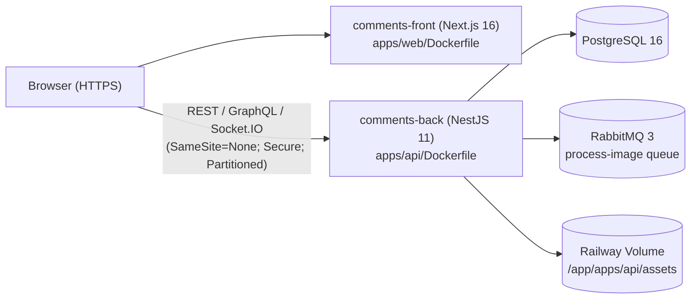

# Деплой на Railway та перевірка чекліста (`chore/deploy`)

Документація production-розгортання SPA «Коментарі» на **Railway** (Docker-образи з монорепозиторію) та результати перевірки живого стенда.

## Live URLs

| Сервіс             | URL                                                                    |
| ------------------ | ---------------------------------------------------------------------- |
| Frontend (UK)      | https://comments-front-production.up.railway.app/uk                    |
| Frontend (EN)      | https://comments-front-production.up.railway.app/en                    |
| REST API           | https://comments-back-production-228b6ee2.up.railway.app/api/v1        |
| Health Check       | https://comments-back-production-228b6ee2.up.railway.app/api/v1/health |
| Swagger UI         | https://comments-back-production-228b6ee2.up.railway.app/api/v1/docs   |
| GraphQL Playground | https://comments-back-production-228b6ee2.up.railway.app/graphql       |
| Socket.IO          | https://comments-back-production-228b6ee2.up.railway.app/socket.io/    |

## Топологія на Railway

## Конфігурація сервісів у Railway

### 1. Backend (`comments-back`)

- **Source Branch:** `main`
- **Watch Paths:** порожнє (інакше Railway ігнорує коміти, що не змінюють сам `Dockerfile`)
- **Persistent Volume:** Mount Path `/app/apps/api/assets` (зберігає завантажені зображення та `.txt` між редеплоями)

| Змінна                    | Значення / Призначення                                                   |
| ------------------------- | ------------------------------------------------------------------------ |
| `RAILWAY_DOCKERFILE_PATH` | `apps/api/Dockerfile`                                                    |
| `RAILWAY_RUN_UID`         | `0` (дозволяє контейнеру `nestjs` писати у примонтований Railway Volume) |
| `NODE_ENV`                | `production`                                                             |
| `API_VERSION`             | `1`                                                                      |
| `DATABASE_URL`            | рядок підключення від сервісу PostgreSQL на Railway                      |
| `DB_SYNC`                 | `false` (схема оновлюється міграціями)                                   |
| `CORS_ORIGIN`             | `https://comments-front-production.up.railway.app` (без `/` наприкінці)  |
| `JWT_SECRET`              | унікальний випадковий секрет production                                  |
| `CAPTCHA_SECRET`          | унікальний випадковий секрет production                                  |
| `COMMENT_QUEUE_MODE`      | `rabbit` (або `memory` без RabbitMQ)                                     |
| `RABBITMQ_URL`            | AMQP URL сервісу RabbitMQ на Railway (для режиму `rabbit`)               |
| `GRAPHQL_PLAYGROUND`      | `true` за замовчуванням (`false` вимикає Playground та introspection)    |

> **Cross-site cookies (`*.up.railway.app`):** бекенд вмикає `app.set('trust proxy', 1)` і автоматично виставляє `HttpOnly; Secure; SameSite=None; Partitioned` для `captcha`, `access_token`, `refresh_token` і `voter_id`, коли `CORS_ORIGIN` або запит (`X-Forwarded-Proto` / `Origin`) використовують HTTPS.

### 2. Frontend (`comments-front`)

- **Source Branch:** `main`
- **Watch Paths:** порожнє

| Змінна                    | Значення                                                           |
| ------------------------- | ------------------------------------------------------------------ |
| `RAILWAY_DOCKERFILE_PATH` | `apps/web/Dockerfile`                                              |
| `NEXT_PUBLIC_API_URL`     | `https://comments-back-production-228b6ee2.up.railway.app/api/v1`  |
| `NEXT_PUBLIC_API_VERSION` | `1`                                                                |
| `NEXT_PUBLIC_GRAPHQL_URL` | `https://comments-back-production-228b6ee2.up.railway.app/graphql` |

> Змінні `NEXT_PUBLIC_*` вшиваються Next.js під час Docker build (`ARG` / `ENV` у `apps/web/Dockerfile`), тому після їх зміни потрібен перебілд образу (`Deploy Latest Commit`).

## Результати перевірки живого стенда (2026-11-24)

Усі 12 перевірок production-стенда пройшли успішно:

| #   | Перевірка                                                       | Результат | Деталі                                                                                                            |
| --- | --------------------------------------------------------------- | --------- | ----------------------------------------------------------------------------------------------------------------- |
| 1   | `GET /api/v1/health`                                            | PASS      | `HTTP 200` — `{"status":"ok","database":"up","graphql":"up","websocket":"up"}`                                    |
| 2   | `GET /api/v1/captcha` + security headers + CORS + cookie        | PASS      | `HTTP 200` SVG, `HttpOnly; Secure; SameSite=None; Partitioned`, `no-store`, `nosniff`, `DENY`, без `X-Powered-By` |
| 3   | `GET /api/v1/comments?page=1&limit=5&sort=createdAt&order=desc` | PASS      | `HTTP 200` — пагінація та сортування працюють (`total=32`, `pageSize=5`)                                          |
| 4   | `GET /api/v1/comments/search?q=hello&page=1&limit=5`            | PASS      | `HTTP 200` — пошук повертає збіги (`matches=4`, з автоматичним PostgreSQL `ILIKE` fallback)                       |
| 5   | `POST /api/v1/comments` із невірною CAPTCHA                     | PASS      | `HTTP 400` — `"Invalid captcha"`                                                                                  |
| 6   | `POST /api/v1/auth/refresh` без cookie                          | PASS      | `HTTP 401` Unauthorized (`AuthGuard` / `AuthService` верифікує підпис і тип JWT)                                  |
| 7   | `GET /api/v1/docs`                                              | PASS      | `HTTP 200` — Swagger UI завантажується                                                                            |
| 8   | `GET /graphql` (`Accept: text/html`)                            | PASS      | `HTTP 200` — Apollo Playground UI завантажується (разом із Docs / Schema)                                         |
| 9   | `POST /graphql` (`health`, `comments`, `searchComments`)        | PASS      | `HTTP 200` — валідні дані без помилок (`health="API is running"`, `total=32`, `searchTotal=4`)                    |
| 10  | `GET /socket.io/?EIO=4&transport=polling`                       | PASS      | `HTTP 200` — Socket.IO handshake із `upgrades: ["websocket"]` та CORS для фронтенду                               |
| 11  | `GET /uk` (Frontend SSR)                                        | PASS      | `HTTP 200` — сторінка рендериться українською (`Коментарі`)                                                       |
| 12  | `GET /en` (Frontend SSR)                                        | PASS      | `HTTP 200` — сторінка рендериться англійською (`Comments`)                                                        |
